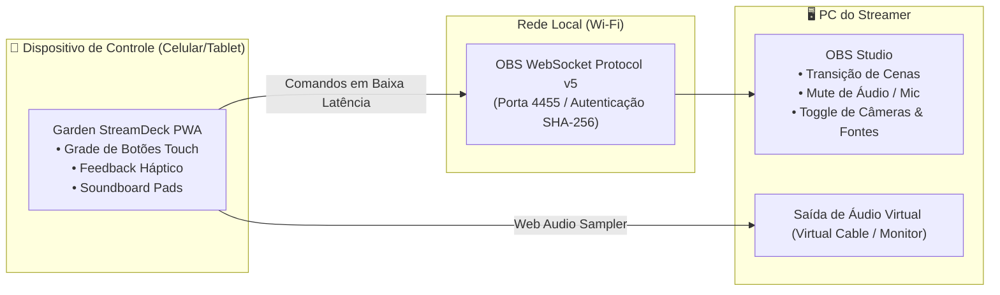

# 🌿 Garden StreamDeck

> **Controladora Sem Fio Virtual & Soundpad Web para OBS Studio**, transformando celulares, tablets ou navegadores em um Elgato Stream Deck sem fio com acionamento de cenas, controle de microfone, efeitos sonoros e feedback háptico.

---

## 🎯 Por que o Garden StreamDeck?

Hardwares dedicados de controle de live (como Elgato Stream Deck) custam centenas de reais e exigem cabos e portas USB ocupadas. Por outro lado, aplicativos de controle móvel frequentemente exigem contas na nuvem, logins de terceiros e têm latência incômoda.

O **Garden StreamDeck** é uma PWA web ultrarrápida:
* **Conexão Direta via OBS WebSocket v5:** Conecta-se diretamente da rede local (Wi-Fi) ao computador onde o OBS Studio roda, com tempo de resposta inferior a 15 milissegundos.
* **Soundboard & Sampler Integrado:** Dispara vinhetas, memes em áudio, palmas e trilhas diretamente pelo navegador com controle de volume individual e Web Audio API.
* **Layouts de Grade Customizáveis:** Grades de 3×2, 4×3 ou 5×3 botões com ícones vetoriais, cores neon e rótulos personalizados.
* **Feedback Háptico em Dispositivos Móveis:** Usa a `Navigator.vibrate` API para fornecer clique tátil perceptível ao tocar nos botões no celular ou tablet.
* **Sinergia com SimpleDrums e Garden SFX Lab:** Importa instantaneamente os efeitos sonoros gerados na suíte Garden Apps para a mesa de som da live.

---

## 🏛️ Arquitetura do Software

---

## 🕹️ Principais Recursos

1. **Ações do OBS Studio:**
   * Trocar para Cena (ex: *Abertura*, *Gameplay*, *Just Chatting*, *Encerramento*).
   * Mute / Unmute de Microfone ou Áudio do Desktop.
   * Ligar / Desligar Câmera ou Captura de Jogo.
   * Iniciar / Parar Gravação ou Transmissão ao Vivo.
2. **Pads de Áudio (Soundpad):**
   * Disparo instantâneo com polyphony (vários sons simultâneos sem corte).
   * Modo Loop ou One-shot com ajuste de ganho master.
3. **Instalação PWA:**
   * Abre em tela cheia sem barras do navegador (*standalone display*), impedindo bloqueio de tela durante a live.

---

## 🛠️ Stack Tecnológica

* **Linguagem:** TypeScript 5.8+
* **Framework:** React 19 + Vite 8
* **Protocolo de Rede:** `obs-websocket-js` (WebSocket v5 nativo)
* **Motor Sonoro:** Web Audio API
* **Mobile UX:** Touch Events + Vibration API

---

## 🌿 Ecossistema GC Studio

Este projeto integra o ecossistema de aplicações criativas mantidas pelo estúdio **GC Studio** (Felipe Gardenghi).  
Para conhecer outras ferramentas da suíte:
* 🎬 **[GardenCut](https://github.com/FelipeGardenghiDev/garden-cut):** Editor de vídeo não-linear web.
* 🥁 **[SimpleDrums](https://github.com/FelipeGardenghiDev/SimpleDrums):** Bateria virtual e sampler de ritmo.
* 🎨 **[Garden Pixel Editor](https://github.com/FelipeGardenghiDev/garden-pixel-editor):** Editor de pixel art e isometria 2:1.
* 🏛️ **[GC Studio Hub](https://github.com/FelipeGardenghiDev/gcstudio):** Central oficial do estúdio.

---

## 📄 Licença
Distribuído sob a licença MIT. Criado por Felipe Gardenghi.
